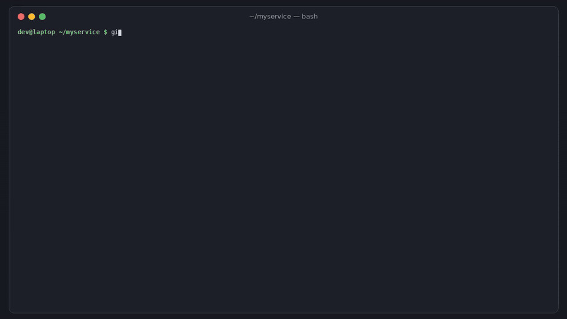

# giltrip

[](https://github.com/hamarshehmhmd/giltrip/actions/workflows/ci.yml)
[](LICENSE)
[](pyproject.toml)
[](#how-it-works)

**You switched to free-threaded Python. Something quietly turned the GIL back on. giltrip tells you what.**

It finds *every* extension module that re-enables the GIL (not just the first one), the package and version it came from, whether it was a wheel or a local build, and, for a real run of your tests or app, the line of your code that imported it.



> Narrated 2-minute demo video: see the [v0.1.0 release](https://github.com/hamarshehmhmd/giltrip/releases/tag/v0.1.0) (`demo.mp4`).

## Why

On a free-threaded build (`python3.13t`, `3.14t`, `3.15t`), importing one extension module that hasn't declared it's safe without the GIL turns the GIL back on **for the whole process, for good**. You get one `RuntimeWarning` naming the first module, and everything after that is silent. Your "no-GIL" service is now a GIL service, and nothing fails.

This keeps biting people, including in packages that ship `cp314t` wheels:

- fonttools: [Published cp314t wheels re-enable the GIL on import](https://github.com/fonttools/fonttools/issues/4393) (Nov 2026)
- manifold: [the free-threaded wheels re-enable it](https://github.com/elalish/manifold/issues/1949) (Nov 2026)
- SQLAlchemy: [2.0.x free-threaded wheels re-enable the GIL on import](https://github.com/sqlalchemy/sqlalchemy/issues/13592)
- aiokafka [#1198](https://github.com/aio-libs/aiokafka/issues/1198), py-questdb-client [#167](https://github.com/questdb/py-questdb-client/issues/167), scout_apm [#867](https://github.com/scoutapp/scout_apm_python/issues/867), cedar-py [#110](https://github.com/k9securityio/cedar-py/issues/110), bitstruct [#56](https://github.com/eerimoq/bitstruct/issues/56) ...
- and downstream: "[SQLAlchemy cext re-enables the GIL and cancels the gain of the other 18 connectors](https://github.com/DataBoar/data-boar/issues/1398)", "[the free-threaded lxml GIL warning breaks the empty-stderr check](https://github.com/JarryShaw/PyPCAPKit/issues/1961)", "[warn when the GIL was enabled during tests](https://github.com/alex-papaioannou/python-ci-workflows/issues/165)".

With Python 3.15 out (Oct 2026) and more teams trying `t` builds, "is the GIL actually off, and if not, who did it?" is a question you want answered in CI, not in a profiler.

## Install

One line (uses `uv tool`, then `pipx`, else a private venv in `~/.local/share/giltrip`):

```sh
curl -fsSL https://raw.githubusercontent.com/hamarshehmhmd/giltrip/main/install.sh | sh
```

Or directly:

```sh
pipx install git+https://github.com/hamarshehmhmd/giltrip
# or, inside your free-threaded venv
pip install git+https://github.com/hamarshehmhmd/giltrip
```

giltrip itself runs on any Python 3.9+ and has no dependencies on 3.11+. The interpreter it *checks* must be a free-threaded build; it uses `--python`, else `$VIRTUAL_ENV`, else `./.venv`, else the Python it runs on.

## Usage

### `giltrip scan`: the whole environment

Imports every extension module in site-packages, each batch in a fresh free-threaded interpreter, and lists the ones that need the GIL:

```console
$ giltrip scan --python .venv --online
giltrip scan  Python 3.14.10 cp314t (/tmp/gtproj/.venv/bin/python)
checked 61 extension modules

GIL re-enabled by 9 modules from 3 distributions:

  lxml 6.1.3  wheel cp314-cp314t-manylinux_2_26_x86_64
    lxml._elementpath
    lxml.builder
    lxml.etree  (loaded by import lxml.builder)
    lxml.html._difflib
    lxml.html.diff
    lxml.objectify
    lxml.sax
    already the latest release on PyPI (18 cp314t wheels), so upgrading won't fix it: tell upstream
    repro: uv run --no-project --python 3.14t --with lxml==6.1.3 python -c "import sys, lxml.builder; assert not sys._is_gil_enabled()"

  questdb 6.1.0  wheel cp314-cp314t-manylinux_2_28_x86_64
    questdb._client
    ...

  scout_apm 4.1.0  wheel cp314-cp314t-manylinux_2_5_x86_64
    scout_apm.core._objtrace
    ...
```

The other 52 modules in that environment (numpy, pydantic-core, SQLAlchemy's Cython parts, cryptography, Pillow, aiohttp, PyYAML, msgpack, psutil ...) keep the GIL off; `-v` lists them. That run took about a second.

Options: `--only DIST` (just your own package, handy for checking a wheel before you upload it), `--exclude GLOB`, `--path DIR` (scan a directory instead of site-packages), `--allow NAME`, `--online` (ask PyPI whether a newer release ships free-threaded wheels), `--format text|json|markdown`, `--exit-zero`.

### `giltrip run -- CMD`: your tests or app, with the line that did it

```console
$ giltrip run -- .venv/bin/python -m pytest -q
3 passed, 1 warning in 0.14s

giltrip run  Python 3.14.10 cp314t (/tmp/gtproj/.venv/bin/python)
watched 1 Python process, 6 extension modules loaded

GIL re-enabled by 3 modules from 2 distributions:

  lxml 6.1.3  wheel cp314-cp314t-manylinux_2_26_x86_64
    lxml._elementpath
      imported at myservice/feeds.py:5
    lxml.etree
      imported at myservice/feeds.py:5
    repro: ...

  questdb 6.1.0  wheel cp314-cp314t-manylinux_2_28_x86_64
    questdb._client  (turned it on)
      imported at myservice/metrics.py:1
```

Plain Python only tells you about `questdb._client`, the one that flipped the switch. giltrip also catches `lxml.etree`, which was imported later in the same process (when the GIL was already on) and would have flipped it by itself. It follows child processes (pytest-xdist workers, subprocesses), keeps any `sitecustomize` you already have, and passes your command's exit code through. Add `--fail` to exit 1 when the command passed but the GIL was re-enabled, and `--report FILE` for JSON.

### `giltrip check MODULE...`: one import

```console
$ giltrip check myservice.metrics --path .
...
  questdb 6.1.0  wheel cp314-cp314t-manylinux_2_28_x86_64
    questdb._client  (loaded by import myservice.metrics)
```

### Allow-list

Some packages you can't drop yet. Put them in `pyproject.toml` (or pass `--allow`):

```toml
[tool.giltrip]
allow = ["lxml"]                 # distribution names, or module globs like "*.speedups"
exclude = ["*.tests.*"]          # scan only: modules not to import
```

Allowed modules are still listed, they just don't fail the check.

### CI (GitHub Actions)

```yaml
- uses: actions/setup-python@v6
  with:
    python-version: 3.14t
- run: pip install -e . pytest
- uses: hamarshehmhmd/giltrip@v0.1.0
  with:
    command: python -m pytest -q     # or leave empty to scan the environment
    args: --allow lxml
```

In Actions, giltrip writes a table to the job summary and a `::warning` annotation per module. Exit codes: `0` nothing re-enables the GIL, `1` something does (scan/check, or run with `--fail`), `2` usage or environment error; `run` otherwise returns your command's own exit code.

## How it works

- CPython, started with `-v`, prints `# loading module 'X', which requires the GIL` for **every** extension module that hasn't declared `Py_mod_gil = Py_MOD_GIL_NOT_USED`, even after the GIL is already on. `giltrip scan` / `check` import modules in fresh interpreters with `-v` and read those lines, so one process finds all of them. (`PYTHON_GIL` is removed from the child's environment, otherwise CPython stays quiet.)
- Modules are grouped by top-level package and run in parallel. If an import crashes or hangs, giltrip marks that module and carries on with the rest in a new process.
- Each module is mapped to its distribution through `RECORD`, and its `WHEEL` tags say whether it came from a published wheel or was built on your machine from the sdist.
- `giltrip run` puts a tiny `sitecustomize` on `PYTHONPATH` that wraps the extension-module loader: it records the GIL state before and after each load and the import stack. Modules loaded after the GIL was already on are then re-checked in a fresh interpreter.

What it can't tell you: whether a module that *declares* free-threading support is actually thread-safe. That's the maintainer's call; giltrip only checks the declaration CPython acts on.

## Fixing it (or asking upstream)

The extension needs to declare support: `Py_mod_gil = Py_MOD_GIL_NOT_USED` (C API, or `PyUnstable_Module_SetGIL` for single-phase init), `# cython: freethreading_compatible=True` (Cython 3.1+), `py::mod_gil_not_used()` (pybind11), `FREE_THREADED` in `nanobind_add_module()` (nanobind) or `#[pymodule(gil_used = false)]` (PyO3). Each finding comes with a one-line `repro:` you can paste into an upstream issue. Until it's fixed, `PYTHON_GIL=0` keeps the GIL off at your own risk.

## Development

```sh
git clone https://github.com/hamarshehmhmd/giltrip && cd giltrip
python -m pip install -e . pytest
uv python install 3.14t          # tests compile small C extensions against it
python -m pytest -q              # or GILTRIP_TEST_PYTHON=/path/to/python3.14t python -m pytest -q
```

## License

[GNU AGPL-3.0-or-later](LICENSE). Commercial licenses without the AGPL obligations are available from the author, Mohammad Hamarsheh: open an issue or contact [@hamarshehmhmd](https://github.com/hamarshehmhmd).
